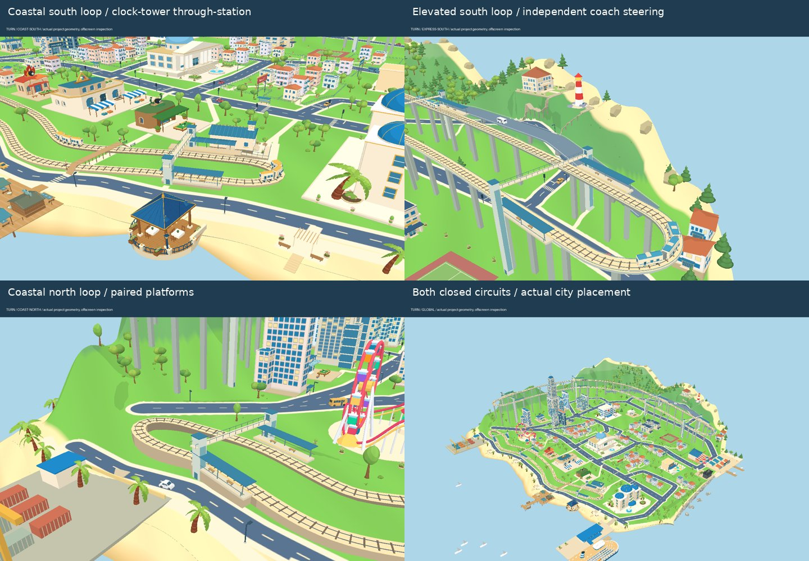

# 海岸总站：通过式站房与回转环

2026-10-23 更新：原单线折返总站已随全局双线改造调整。当前设计和完整轨道交通规划见 [rail-network.md](rail-network.md)。旧版本的止冲器和端部横向护栏已移除；列车到站停留四秒后继续向前，经南端半椭圆弯进入另一条轨道。

保留奶油色拱券站房、青蓝独立坡顶、小钟塔及花园前场。站房整体向南、向内陆调整至 M16，沿内陆轨道布置 22 米站台；另一侧站台通过跨轨步桥及升降机连接。站前台阶和坡道接入东侧道路，避免步行通道穿过南端回转弯。坡道出口调整到外侧花园，其转角保留平整平台。

所有原件、组合及实际网格坐标见 [placements.json](rail-review/placements.json) 中的 `coastStation`、`stations` 和 `routes`。资产查看器可分别检查站房、屋顶、钟面、雨棚，以及完整总站和两种列车。

渲染为项目实际几何的离屏检查，使用简化光照；当前浏览器 WebGL 不可用，尚未完成浏览器实景验收。
