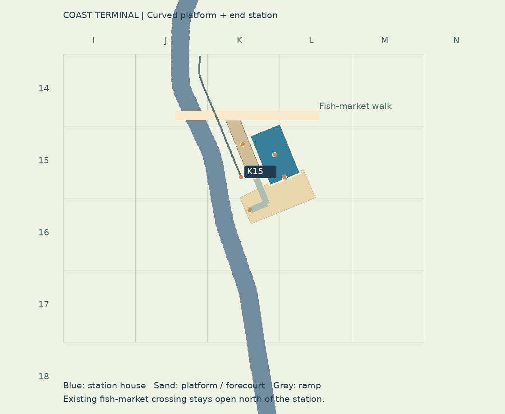
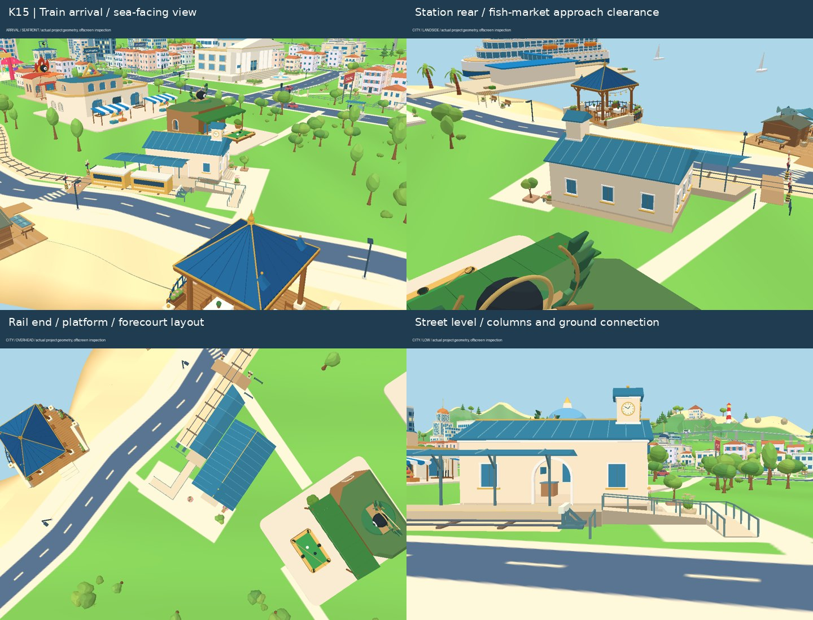
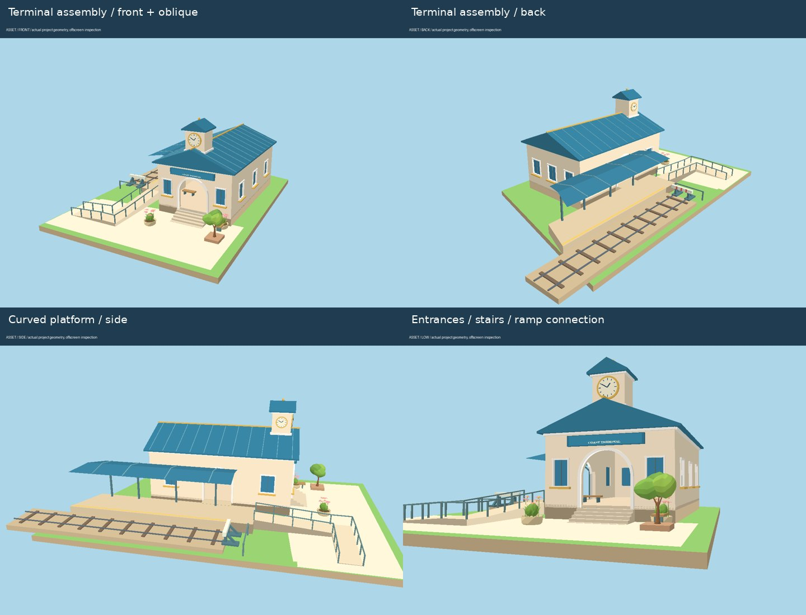

# 海岸总站：轨道南端设计与落位（2026-10-23）

基线：远程 main `a945a65585cf5698c83d8179a463c8b62678a313`。目标是截图中鱼市旁的地面电车南端，不是东侧高架铁路。轨道端点约 **(-50.790, 1.460, 74.000)，K15 网格**；沿用原有线路和两节编组，在内陆侧布置地方铁路终点站。

## 设计与分组

采用奶油石墙、青蓝金属坡顶、金色细部与小钟塔，保持鲜艳、清晰的漫画手游风格。站房控制为单层高厅，不遮住街角台球厅的主体；以钟塔、拱券和长雨棚形成新的海岸地标。

| 原件分组 | 原件 | 组合 |
| --- | --- | --- |
| 站房 | 挤出留洞的墙板、拱券石框、内凹玻璃、窗台、檐口 | 正面主入口、侧面站台入口、背面服务立面、售票柜台、等候座椅；入口中部保留通路 |
| 独立屋顶 | 青蓝坡顶、金属立缝、金色脊条、钟塔基座、立体钟面 | 主屋顶与钟塔独立组装；钟面高于主屋脊，避免遮挡。钟面为固定造型装饰 |
| 沿轨站台 | 实体台基、黄色警戒/触觉带、连续雨棚、外侧柱与斜撑 | 按实际轨道曲线生成；靠鱼市的一端裁切退让，避免封堵既有步道 |
| 轨道终端 | 止冲器脚座、斜撑、红白端梁、末端护栏 | 留出列车停车余量，不能以站房墙体充当轨道终点 |
| 站前空间 | 实体基础、五级台阶、两段坡道、平整转角平台、花园座椅 | 主入口接站前广场；坡道外缘设扶手，转角两条通行边保持开放 |
| 导航与查看 | 地图标签、总站镜头、站房/屋顶/钟面/雨棚/止冲器原件 | 完整总站预览携带自己的地块、站前铺装和末端轨道，隐藏地图后仍可独立检查 |

## 网格和通路

完整坐标、组合部件 ID、边界、广场和接入步道记录在 [placements.json](station-review/placements.json)，运行时可读 `world.userData.coastalStation`。网格仍为 20 米：X=-260、Z=-220 为原点。

| 控制点 | 网格 | 世界 X / Y / Z（米，约） |
| --- | --- | --- |
| 站房基准 | K15 | -41.267 / 1.910 / 67.956 |
| 主入口地坪 | L15 | -38.548 / 2.060 / 74.623 |
| 钟面中心 | L15 | -38.707 / 9.760 / 74.234 |
| 站台检查点 | K15 | -50.201 / 2.010 / 65.117 |
| 止冲器检查点 | K15 | -50.733 / 2.660 / 74.139 |
| 坡道出口 | K16 | -48.284 / 1.137 / 83.454 |

- 站房与沿轨雨棚放在内陆一侧，实体顶点距车道最小约 2.73 米。站前地面步道另接到实际路侧人行区，不覆盖车道。
- 鱼市原步道位于 Z=57 附近；总站实体在该侧均退至 Z≥58.5，原道口栏杆和步道继续保留。
- 站台名义长度 16.4 米，北端按步道边界裁切。列车停稳时两节车厢中心均在站台范围内，车头与止冲器之间保留余量。
- 站台坡道有 1.8 米宽的平整转角，斜坡段合计 11.05 米、高差约 0.873 米；主入口地面通路从坡道末端外侧绕行，避免被扶手或坡道侧墙挡住。
- 提前为总站保留地块，并让随机植被、后续灯具和住宅避让；地块基础与站台底部封闭，入户末级台阶接到真实地面。

## 动态与材质

海岸电车抵达两端后停留 4 秒再折返，保留余下帧时间，避免帧率差异造成行程漂移。“暂停动画”和资产查看模式也暂停这段停留计时。高架通勤列车保持原来的运行方式。

站房玻璃接入原有夜间暖光，雨棚附近壁灯连续随夜色点亮；奶油色墙面和屋顶不发光。站房墙体、钟面、窗框等使用实际几何，只有站名牌使用文字贴图。固定站房、雨棚、站台及园景按材质合批，保留玻璃、文字贴图和夜间灯具的材质角色。

## 检查

69 项自动检查及 TypeScript/生产构建通过。新增回归包括：端点和网格吻合、完整实体不占道、鱼市通路净空、列车止冲余量、到站停留与不同帧长的一致性、坡道转角与台阶接地、钟面不被屋顶遮住，以及合批后雨棚两侧法线朝上。

检查了正面、侧面、背面、斜视、低角度与底部；分别查看完整城市、独立总站组合及电车停站画面。修正了钟面被屋脊遮挡、坡道转角护栏不连贯、站房后角侵入鱼市步道净空、雨棚一侧法线朝下及支撑连接的问题。

当前检查环境的浏览器 WebGL 不可用。下图为项目实际几何、材质纹理和实例植被的 Mesa EGL 离屏检查，使用简化光照；不等同于浏览器实景截图。浏览器交互、完整昼夜成片和设备帧率仍未完成实景验收。

