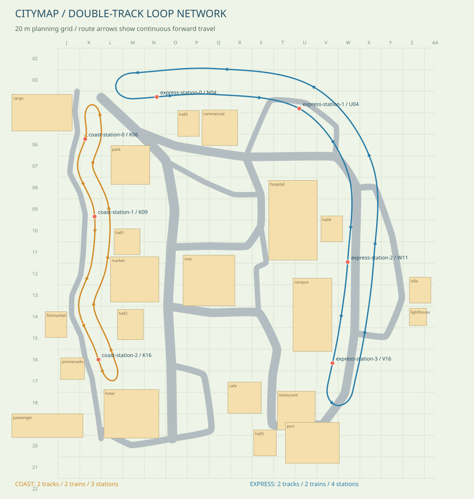
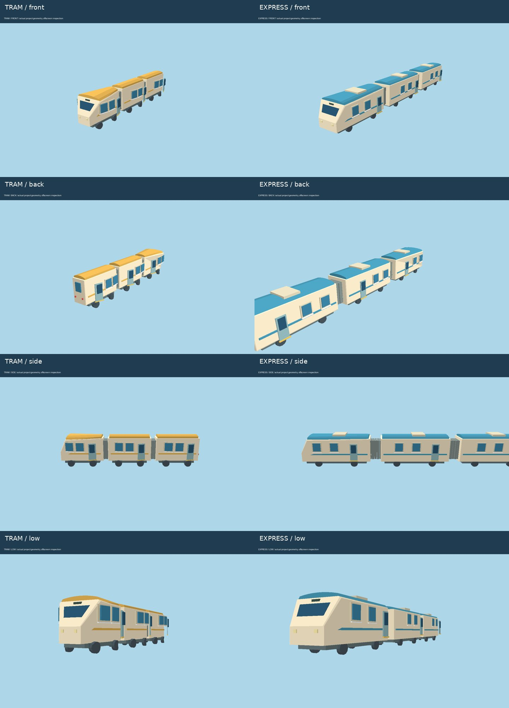

# 双线环行轨道交通（2026-10-23）

远程基线：`a9d27ed0b0d81526af7e4ea122324e9c9513a7c7`。将海岸电车与山麓高架铁路一起改为**双线、两端半椭圆连接、单向闭环运行**。每条线路两列车，以相隔半圈的位置发车；到站停留四秒，随后沿当前方向继续前进，不倒车、不瞬移折返。

这里的双线是两条并行行车轨道，每条都有左右两根钢轨，即普通区段可见四根钢轨。端部两条行车轨道连接为同一个闭环。站台设在回转弯之前，回转弯用于列车向前转向，不作为停车站台。

## 原件 → 组合 → 落位

| 原件分组 | 制作内容 | 组合规则 |
| --- | --- | --- |
| 轨道 | 两根连续钢轨、枕木、轨床、闭合底板与侧壁 | 上下行平行，端部半椭圆；统一线路数据驱动渲染、车辆与占地避让 |
| 高架结构 | 连续梁、低矮防护边、承台、落地桥墩 | 桥墩完整脚座避开车道，曲线段和回转端也有支撑；轨面按连续缓坡生成 |
| 车头 | 挤出及倒角车壳、斜面挡风玻璃、目的地牌、车灯、雨刷 | 前进方向一致，玻璃置于真实车头斜面之外，不藏入外壳 |
| 客车 | 分立车窗/窗框/窗台、滑门、腰线、独立弧形车顶、轮轴、底盘 | 三节编组；车端收窄，避免弯道内侧互相穿插 |
| 连接部 | 独立折棚、车间连接 | 每节车厢根据前后轮位分别计算朝向；折棚跟随实际两车端点，长度与方向随弯道变化 |
| 车站 | 双侧站台、警戒带、雨棚、座椅、站台方向牌、跨轨步桥、电梯 | 柱子位于行车净空之外；两侧站台按各自轨面高度和坡度生成，乘客通过步桥换边 |
| 海岸总站 | 原钟塔站房、22 米沿轨站台、站前花园、台阶与坡道 | 改为通过式车站，移除止冲器及横向端部护栏；站前步行接到东侧道路，避免再横穿回转环 |
| 鱼市道口 | 四条轮缘槽、木板铺装、桩柱与横梁、双侧栏杆 | 沿鱼市实际步道的世界 Z=57 穿越两条轨道，槽口按真实交点/切线裁切；预警同时检查两列车 |

## 全局空间调整

- 海岸主线保留在海滨道路内陆一侧，另一条轨道向内陆展开。轨道中心最小距车道边缘约 **3.75 米**，包括轨床宽度仍留有余量。
- 海岸南端回转区延至 Z≈112，位于酒店北侧空地。钟塔站房移到 L16–M16 一带，与鱼市原步道和街角球馆分开。
- 台球用品市场整体东移，炽焰球馆和街角球馆同步让位；游乐园整体调整位置及水平占地，保留设施组合和独立动画关系。
- 山麓铁路主线整体向西调整，为第二条轨道及高架公路留出独立空间。桥墩的完整平面占地避开地面行车道；高架轨道采用约 4.5% 的连续坡度上限，避免整条线路维持不必要的统一高标高。
- 先构建并登记交通设施、接入步道和完整占地，再生成普通建筑及住宅小区。住宅保留 **14 组小区**；绿植按照完整树冠/花盆占地避让两条轨道、回转弯及车站。
- 全局网格继续为 20 米。完整线路采样、车站坐标、站房及坡道坐标、移动后的地标位置均记录在 [placements.json](rail-review/placements.json)。

| 线路 | 双线间距 | 车站网格（线路基准点） | 编组与运行 |
| --- | --- | --- | --- |
| 海岸环行电车 | 14 米 | K06、K09、K16；钟塔站房位于 M16 | 两列黄色三节短车体，双向站台共六个停车点 |
| 山麓环行列车 | 24 米 | N04、U04、W11、V16 | 两列青蓝色三节列车，双向站台共八个停车点 |

## 尺度与运行边界

采用真实的双线交通组织、通过式站台、跨轨换边和连续前进原则，但车辆长度、回转半径和海岸坡度按卡通城市地图压缩；不能作为现实铁路工程尺寸或运营安全标准。海岸紧凑回转弯配短车体，山麓回转区加宽并使用更大的半径。

停车计时采用事件推进，保留一帧内剩余时间；暂停动画或进入资产查看器时不会推进。车辆在不同帧长下仍按相同时间到站和离站。当前地图交通继续使用恒定巡航速度及停车等待，未模拟完整的加速、制动或调度系统。

资产查看器新增两种列车的完整编组、独立车头和客车原件。总站预览同时显示另一侧站台、跨轨步桥和第二条轨道，便于脱离完整地图检查。

## 渲染与回归检查

检查完整城市中的北端/南端、线路与道路交叉、列车回转画面；列车原件检查正面、侧面、背面、低角度及底部。修正了挡风玻璃内嵌、弯道内侧车体交叠、折棚预览位置、坡道出口和道口木板缺少支撑的问题。

72 项测试及 TypeScript/生产构建通过。其中包括：两条完整闭环的连续连接、地形/道路/固定地标避让、桥墩完整脚座避让、四条轮缘槽保持开放、全车厢停靠站台、完整环线逐段车体碰撞检查、四列车连续十分钟运行、不同帧长的停车计时一致性。

当前浏览器 WebGL 被禁用。下图来自项目真实几何、纹理和实例植被的 Mesa EGL 离屏渲染，采用简化光照；不等同于浏览器截图，完整昼夜与设备帧率尚未实景验收。

