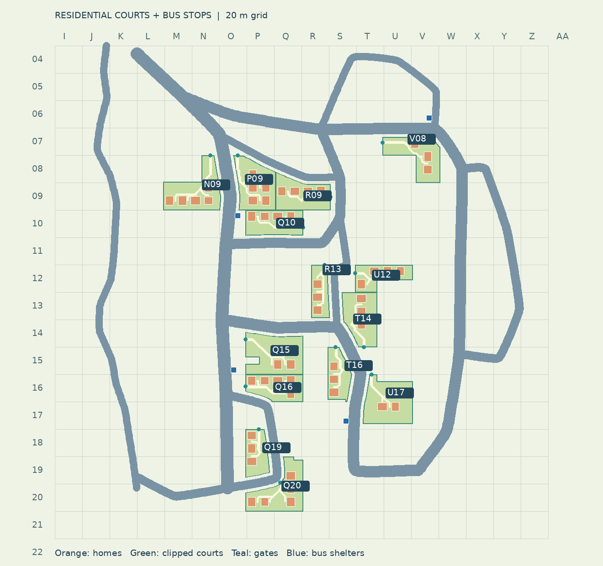
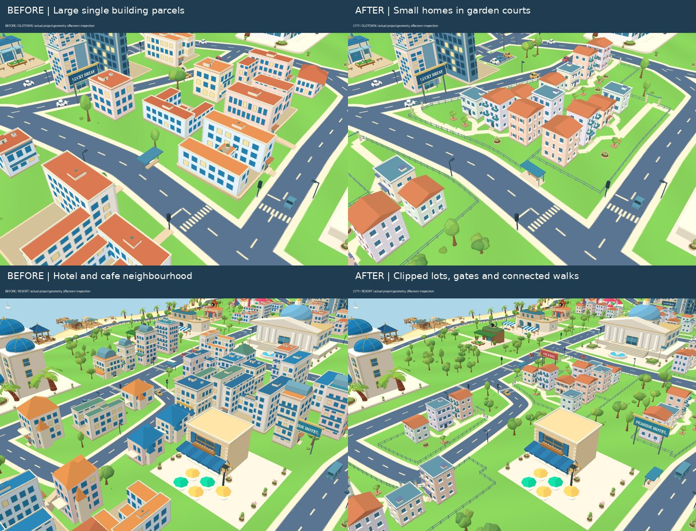
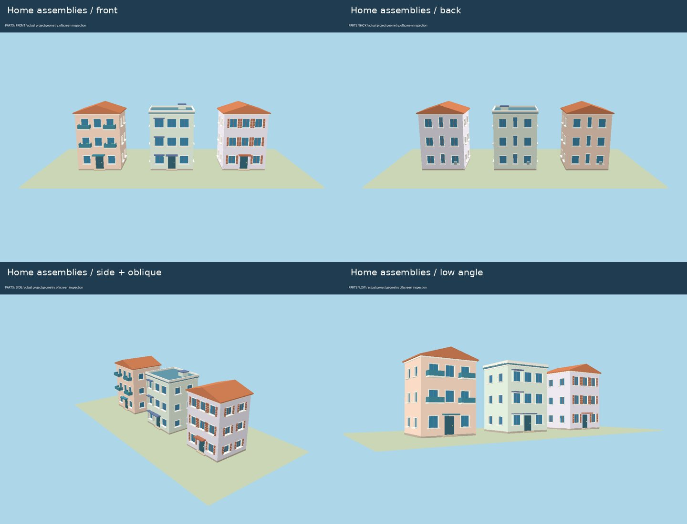
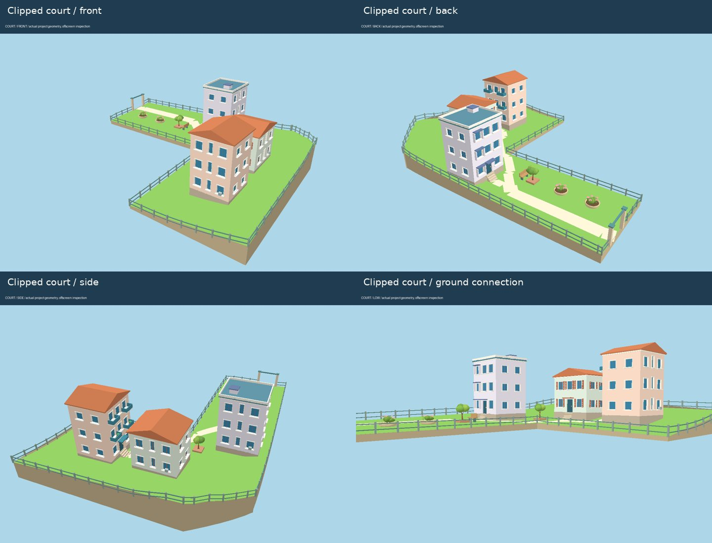
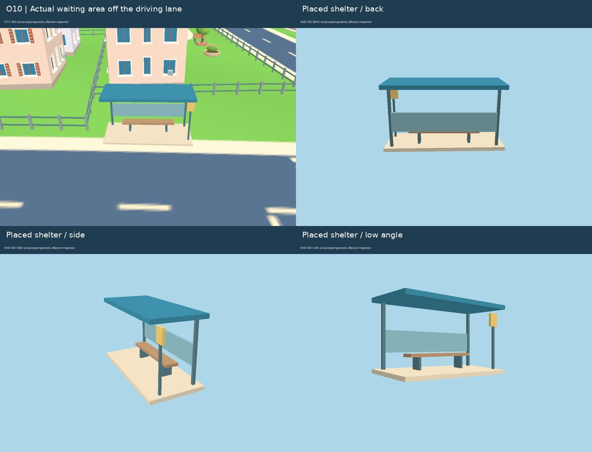

# 小体量住宅与公交候车亭（2026-10-23）

基线为远程 main `cb59bab9a0e81162e596c4c5a0f0916d5ca44ef8`。先整理楼面原件、住宅与庭院组合，再按实际道路/地标空地裁切落位。沿用 20 米网格；完整楼栋 ID、网格、坐标、朝向、小区边界、大门、步道折点与公交站坐标见 [placements.json](residential-review/placements.json)。运行时可读取 `world.userData.residential` 与 `world.userData.busStops`。

## 元素与组合

| 层级 | 元素 | 实际组合 |
| --- | --- | --- |
| 住宅墙面 | 有厚度的墙板、真实窗洞、内凹玻璃、窗框/中挺、外挑窗台 | 玻璃位于墙面后方，墙板挤出时留洞；没有住宅窗格贴图。正、侧、背面分别布置生活窗、楼梯窗和通风设备 |
| 住宅类型 | 生活阳台、窗侧墙与遮檐、百叶窗 | 三种立面组合；混合两层/三层、墙色、入住亮窗、屋顶形式与阳台花箱 |
| 屋顶 | 坡顶、独立平屋面、女儿墙、楼梯间 | 作为单独屋顶分组，不让立面材质覆盖屋面 |
| 入口 | 内凹门、短门槛、雨檐、随地形下降的台阶 | 每栋单独确定基础标高，台阶末级接到真实地面与内部步道 |
| 小区 | 3—5 栋住宅、围栏、大门、步道、共享花园 | 共 14 组、54 栋。单栋宽 6.2—6.8 米、深 5.5—5.9 米、2—3 层，替代原先较大的零散住宅体块 |
| 花园 | 树池、绿冠小乔木、花盆、座椅 | 避开楼栋与步道，零散森林不再生成到小区内部 |
| 公交候车区 | 贴地站台、立柱、雨棚、挡风屏、座椅与落地支撑、站牌 | 四站按道路切线/法线定位，核查整个棚顶及站牌占地，避免只检查柱子 |

住宅固定几何按材质合并，玻璃保留入住/未入住两类材质。夜晚只有选中的玻璃产生暖光，墙板和屋顶不发光。新增三种单栋住宅、小区组合及公交雨棚资产；查看器中的小区带独立裁切地块和步道，隐藏地图后也能检查。工具栏新增“花园住宅小区”和“公交候车亭”。

## 地块与网格

先从候选网格区域中扣除实际弯道路缘、地标、既有楼体、停车场/步行出入口、电车走廊与广告牌。住宅、阳台、屋檐的完整占地必须落在剩余多边形内；围栏顺着其边界分段落地，仅在连接道路的位置留出约 3.8 米大门。

花园与楼栋共同筛选，内部步道绕开邻栋连接各个前门。主入口接到现有路侧步行区，不穿越另一小区或地标；步道绘入共享地面，避免额外路面与坡地闪烁。坡地逐栋做实体基础和入口台阶，不把整个小区抬成一块高平台。

| 小区规划网格 | 楼栋数 | 小区规划网格 | 楼栋数 |
| --- | --- | --- | --- |
| V08 | 3 | N09 | 5 |
| P09 | 5 | R09 | 4 |
| Q10 | 4 | U12 | 4 |
| R13 | 3 | T14 | 3 |
| Q15 | 4 | Q16 | 5 |
| T16 | 3 | U17 | 3 |
| Q19 | 3 | Q20 | 5 |

表中是小区规划锚点网格；跨格地块的每栋住宅另有自己的网格和精确坐标，不能把整个小区当成单格摆放。

| 公交站 | 网格 | 世界 X / Z（约） | 服务道路 |
| --- | --- | --- | --- |
| 1 | O10 | 33.5 / -35.8 | 中央大道 |
| 2 | O15 | 30.5 / 76.8 | 中央大道 |
| 3 | V06 | 173.1 / -107.2 | 山居支路 |
| 4 | S17 | 112.5 / 114.2 | 港湾大道 |

原有雨棚直接用固定坐标生成，没有对整个棚顶做车道检查。现改为完整候车亭组合定位，站台顶面及立柱/座椅脚贴合地形。第四站原目标附近坡度与可用空间不合适，移至约 67 米外的平缓港湾路侧；不硬塞回原位置。高架设施按支撑柱与站体占地避让，没有把整条高架下方都视为不可用土地。

## 检查与交付范围

64 项自动检查通过，TypeScript 和生产构建通过。新增检查覆盖完整住宅/屋檐/阳台占地、每栋网格、内部步道避让邻栋、真实窗洞和独立屋顶、玻璃材质分类、公交雨棚所有角点不占道、入户末级台阶接地、独立预览地块，以及随机植被避让住宅。

实际几何检查按正面、侧面、背面、斜视、低角度进行，覆盖单栋住宅、裁切小区、落位雨棚和完整城市。修正了邻栋挡路、偏置花园导致楼栋挤在一侧、台阶与地面不连续、预览小区没有独立步道，以及随机植被可能长入新小区的问题。基线与修改后城市使用同一镜头作对照。

当前检查浏览器禁用 WebGL。本轮图片是项目实际几何（包含实例植被）及纹理的 Mesa EGL 离屏检查，使用简化光照；不等同于浏览器实景截图。浏览器资产查看器交互、完整昼夜成片与设备帧率仍未完成实景验收。

