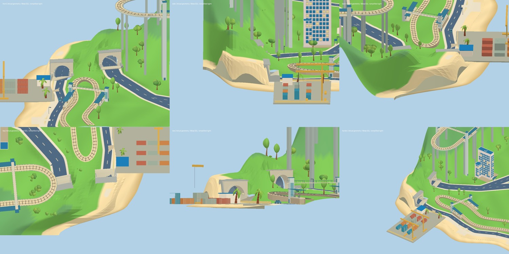
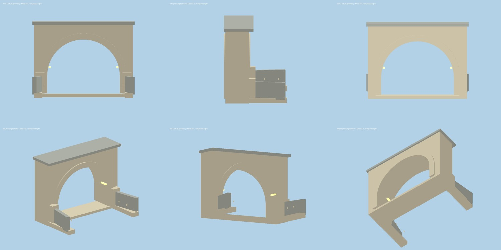
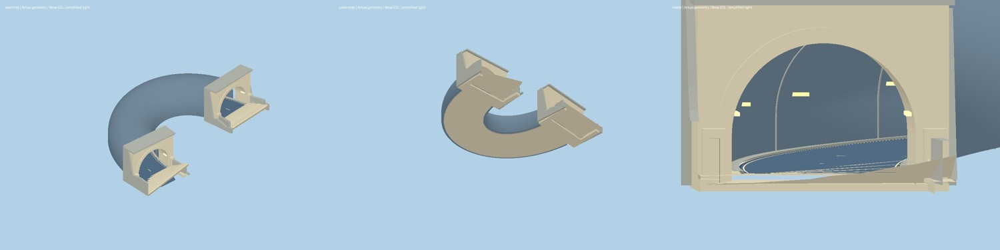
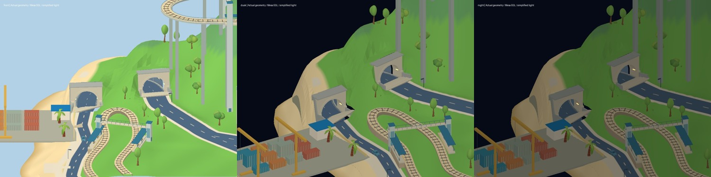
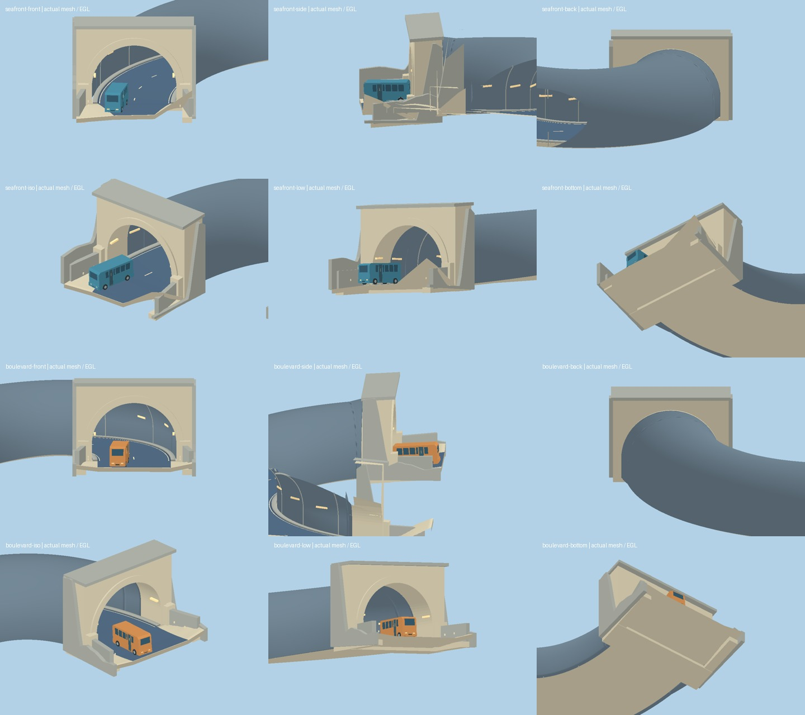

# 货港穿山公路 · 2026-10-23

基于远程 main `862996c18d0d3ccdf319795388f17e990626cb23` 制作。入口：工具栏 **货港隧道**；原件和组合可在资产查看器搜索“隧道”。

## 场地判断与最终路线

两个目标是货运码头东北的海滨公路、中央大道北端。海滨端处于很薄的山脚，直接延长道路会把路画到坡面；原中央大道端点附近又有海岸电车北部回转环。第一版仅改变大道末段切线时触发铁路道路净空回归，已撤回。

最终保留海滨端位置，将中央洞口从 (-40,-154) 向东北退让到 (-32,-165)，约 13.6 米，室外接路同步调整。两洞口之间是一条双向连续的覆土隧道，车辆从另一洞口驶出；山脚薄处局部抬起覆土，与原山坡过渡。没有把整座山挖成露天沟，也没有向海上延伸道路。

| 位置 | X / Y / Z（米） | 20 米网格 | 朝向与接路 |
| --- | --- | --- | --- |
| 海滨洞口 | -62.407 / 2.275 / -160 | J04 | 接原海滨路，5 米路面渐宽至洞内 9 米 |
| 大道洞口 | -32 / 7 / -165 | L03 | 向东南接 (-29,-148) 及原大道，9 米宽 |
| 地下轴线 | 三次贝塞尔，约 53.49 米 | 详见坐标文件 | 平面最小半径约 12.61 米；最大纵坡约 10.65% |

这是压缩尺度的漫画地图山路，弯道与坡度不作为现实公路工程标准。两侧各一个车道，路面 9 米，内半径 5.2 米、起拱高 2.1 米，中央净高 7.3 米；现有长 5.7 米、宽 2 米的公交车逐段检查转弯包络。完整轴线、洞口朝向、开口/挡墙边界及灯具锚点见 [placements.json](tunnel-review/placements.json)。

## 原件、组合与集成

- 原件：真实挤出的开口拱圈、带孔门脸、独立顶檐、桥台/基础、翼墙、灯具与反光标。无黑色封口面。
- 洞体：沿同一轴线扫掠内外衬砌，包含两端截面和底部边缘；结构接缝分段重复。连续路基有顶、底及侧面，支撑路面和两侧路缘。
- 洞口组合：按各自纵坡剪切洞口深度；挡墙从基础一直接到真实地形高度。接路板渐变到原路的高度和宽度，保留薄板厚度和底面。
- 地形：共享高度场只局部增加覆土；在两个洞口对实际三角面进行多边形裁切，保持原三角面高度/颜色的重心插值。隧道侧壁、洞口实体和挡墙封闭切口。
- 避让：完整洞体及洞口边界先登记到建筑和植物预留；植物按全树冠足迹避让。中央大道的控制点同时更新到公共布局数据。
- 路面：地下采用独立几何，不参与户外道路整平和遮罩绘制。还清除户外圆头笔触在洞口背后留下的遮罩，防止山顶出现道路斑块。
- 交通：合并中央大道、地下洞体与海滨路的车辆源路径，只在两个室外远端保留折返连接。洞内和接路板通过独立可行驶高度定位车辆，并按真实行驶面修正俯仰。红绿灯继续使用原道路编号/相位。
- 昼夜：灯具复用既有 `station-light` 光照角色，随现有昼夜权重调整自发光；岩石、门脸和挡墙不加入发光材质。衬砌只保留微弱冷色环境补偿。

## 实际检查、修正与回归

完成原件/组合的正、侧、背、斜视、低角度、内部及底部检查；完整场景检查两个洞口、码头方向、山后、俯视及铁路邻接关系。修正了：第一版大道接路侵占电车回转区、海岸侧覆土收口缺失、道路朝下面、洞口地形封口、拱圈与衬砌接缝，以及海岸高度查询的 Float32 边界误差。

最后一个问题只从山后视角显现：解析海岸线与 Float32 网格存在微米级误差，高度查询误判在陆地外并返回旧高度，导致抬高后的山坡和海岸挡墙之间出现三角形裂口。已增加边界容差并逐行核对海岸顶点。

新增回归覆盖真实孔洞、内外法线、独立车行高度、山顶覆土、完整洞体在陆地内、曲率与坡度、长公交车全程包络，以及六辆公交/轿车连续十分钟通过两端且无重叠。既有铁路、住宅、交通和昼夜测试保留。

## 检查证据及边界

本轮重新打开线上浏览器，仍收到 `WebGL context could not be created / GL_RENDERER = Disabled`。以下图片来自 **项目真实几何、材质颜色、Canvas 纹理和实例植被的 Mesa EGL 离屏渲染**，启用背面剔除，使用简化光照；不是浏览器截图。晨昏/夜色图只检查简化亮度下的结构可读性，未复现完整 SunCalc、阴影、水面或设备帧率，不能宣称完整昼夜实景验收。

最终 **80 项测试全部通过**，包含接通隧道后的 28 辆车五分钟路网运行；TypeScript 与生产构建通过，差异空白检查通过。

验证命令：`npm test`、`npm run build`、`git diff --check`。发布沿用现有 Actions build → Vite dist → Pages 流程。最终提交及 Actions 状态以仓库实际记录为准。

## 第二轮复查：洞口接地与衬砌接口

远程基线 `8d3ab67`。复查实际三角形后修正三处问题：

1. **车辆接地与接路板不一致。** 原高度函数在车辆当前 X/Z 采样山坡，接路板则只在两侧边缘取样并三角化，两者在大道洞口最大相差约 **0.213 米**。新增 `src/tunnelAprons.ts`，让几何和车辆查询共享同一组 Float32 顶点及三角形；两洞口、双车道密集射线复核，误差低于 0.0001 米。
2. **基础板覆盖沥青。** 原宽基础板仅由两个外侧山坡采样点连成平面，在海滨洞口的车道采样点会高出沥青约 **1.65 米**。基础现在分成“外侧肩部—左车道边—右车道边—外侧肩部”，中部严格位于路面下 4 厘米，外侧再接山坡。实体封闭算法同步支持多列网格；底面和全部边界保持闭合。
3. **直洞口与弯曲衬砌之间的开缝。** 将主衬砌起点退至洞内 5.4 米，新增从洞口深处 3.8 米截面过渡到主衬砌的实体连接段。两个方向分别处理法线，连续射线检查顶面、左右侧壁均有实体遮挡。

用实际路线中的公交车姿态重新导出两端组合，检查正、侧、背、斜视、低角度和底部。以下图优先于上方保留的首轮检查图；这是实际几何的离屏检查，仍不是浏览器 WebGL 验收。

可复现检查：在提供 Mesa EGL 的环境安装 Python `moderngl numpy Pillow`，执行 `node scripts/review/tunnel-contact.mjs`。脚本直接导出项目原件、实际行驶路线姿态和材质颜色，不重新绘制替代模型；只使用简化固定光照。

第二轮验证结果：**83 项测试通过**，TypeScript/生产构建通过，`git diff --check` 通过。新增检查独立射线比对实际接路板、基础不穿沥青、实体网格边闭合、缓存剖面不被预览修改，以及两端过渡段的连续顶面和侧壁。昼夜逻辑本轮未改动，完整浏览器 WebGL 与设备帧率的验证边界继续保留。
