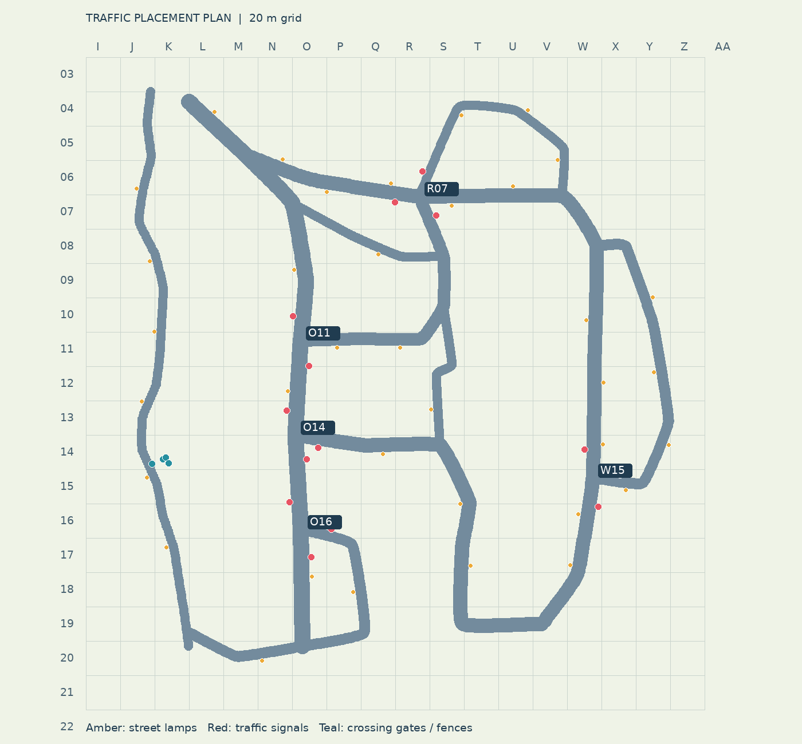
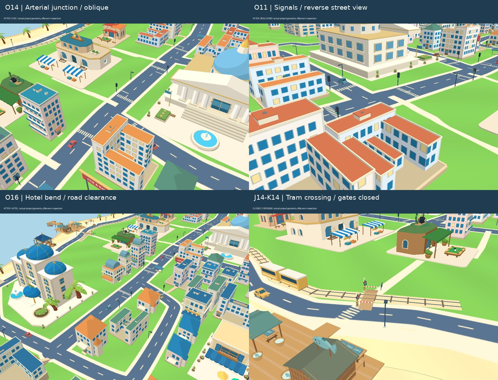
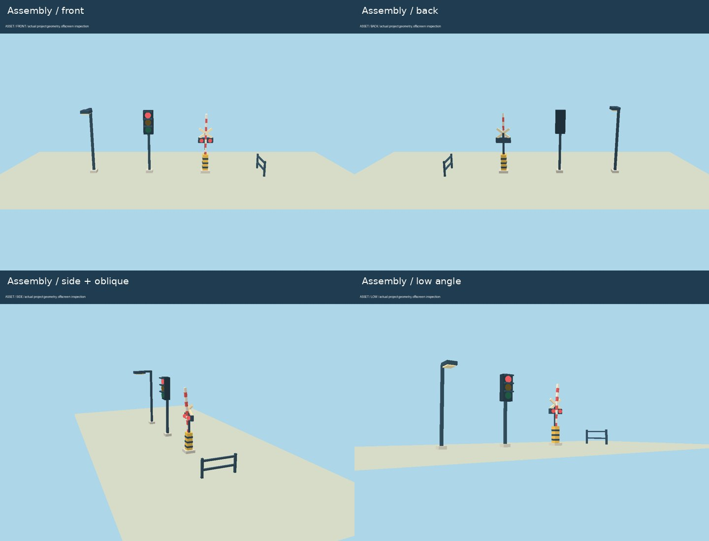
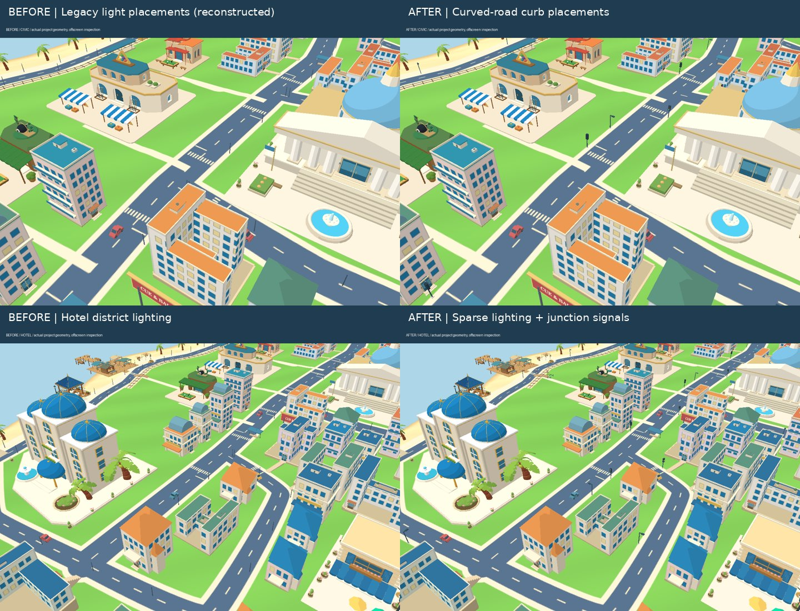

# 交通设施规划与落位（2026-10-23）

基线：远程 main `94d1a0708341ba3ea838f72043935c22d98ee8c7`。沿用现有 20 米网格，左上原点 X=-260、Z=-220；完整落点见 [placements.json](traffic-review/placements.json)，包含 ID、网格、世界坐标、朝向、道路及路口编号。运行时同一清单位于 `world.userData.trafficInfrastructure`。

## 问题与规划

旧方案共有 148 盏灯，每约 15 米沿控制点直线插值，并始终向世界 X 偏移。72 个灯杆落点距离实际道路边缘小于 0.3 米，弯道、横向道路与路口尤其明显。新方案按实际样条切线/法线、完整底座占地落位，并检查所有邻接道路、停车场/建筑入口、建筑占地和地面电车走廊。

| 分组 | 原件 | 组合与落位 |
| --- | --- | --- |
| 路侧照明 | 地基、灯杆、悬臂、灯箱、暖光透镜 | 36 盏；主路目标间距 36 米、支路 43 米；全局最小间距 25 米；路口与入口留空，无法安全放置就跳过 |
| 路口信号 | 地基、立杆、三色灯箱、遮阳檐 | 5 个主要路口、16 组灯；沿来车方向朝向；停车线和斑马线绘入共享地面贴图 |
| 电车道口 | 电机箱、黄黑警示带、双红灯、十字警标、红白升降杆 | 鱼市地面电车步行道口两侧各一组；海侧没有空间继续放导向栏杆，保留道路净空 |
| 道口导向 | 落地柱、双横杆 | 内陆侧两段短栏杆，位于步行通道外侧；避免封住入口 |
| 检查入口 | 资产查看器、镜头预设 | 新增 4 种交通组合资产与“路口交通”“电车道口”快捷视角 |

| 路口中心网格 | 位置 | 信号灯数量 |
| --- | --- | --- |
| O11 | 中央大道 × 市政接入路，约 (25,-15) | 3 |
| O14 | 中央大道 × 港湾大道，约 (22,40) | 3 |
| R07 | 医院环路 × 市政接入路/山居支路，约 (94,-99) | 4 |
| O16 | 酒店车道 × 中央大道，约 (26,95) | 3 |
| W15 | 东山道路 × 医院环路，约 (195,65) | 3 |
| J14 / K14 | 鱼市电车道口，约 (-58,57) | 2 组栏杆、2 段导向栏杆 |

## 联动与几何约束

信号周期 52 秒：主路绿 22 秒、黄 3 秒、全红 3 秒；支路绿 19 秒、黄 3 秒、全红 2 秒。路口错开相位。红/黄灯在停车线前限制车辆前沿，已经越过停车线的车辆继续清空路口；原有路口独占预约继续处理相交路线，避免支路同时绿灯时的冲突。

电车距离道口 67 米以内开始交替红灯并关闭栏杆，关闭用时 1.6 秒，驶离后延迟 4 秒打开。升降臂始终在轨道两侧，不扫入列车车身包络；只处理真实存在的地面步行道口，高架通勤铁路不放平交栏杆。暂停动画和资产查看模式同时暂停交通信号及道口运动。

延长模拟发现花园支路急 S 弯会让两辆长公交相互卡住。现在急弯也预约完整车身通过范围，避免对向长车同时进入。普通住宅小路口继续使用预约机制，没有为每个小路口铺设信号灯。

底座按最终位置/朝向贴合地形；灯臂位于 4.3 米以上。灯具透镜随夜色发光，移除旧的大量悬浮光斑。固定支撑按材质合并，三色透镜、警灯及升降臂保留独立状态；没有新增逐灯 PointLight。

## 渲染检查与验证范围

59 项自动检查通过，TypeScript 与生产构建通过。新增回归覆盖道路/地面电车避让、灯距、网格、入口排除、信号相位/全红、停车线前沿、栏杆升降包络与公交急弯预约。

实际生成城市的 28 辆车连续模拟 20 分钟：车辆重叠 0 次，道口进入列车接近范围但未关闭 0 次，最长单次等待约 32.5 秒，每辆车累计行驶超过 3902 米。

当前云浏览器禁用 WebGL，线上页面报 `GL_RENDERER = Disabled`，因此本轮不能提供浏览器实景截图或确认设备上的交互与帧率。以下为项目实际城市几何/材质纹理的 Mesa EGL 离屏检查图，使用简化光照，不等同于完整 Three.js 浏览器成片。检查了组合正面、背面、侧面、斜视与低角度，以及路口正反向、酒店弯道、道口开放/关闭；修正了临海道路上旧警标、导向栏杆占道和 O14 一侧信号无法落位的问题。

“修改前”图根据基线的旧路灯位置算法重建，作为灯杆落位对照；背景道路使用当前共享地面，不能作为整张地图的历史截图。

